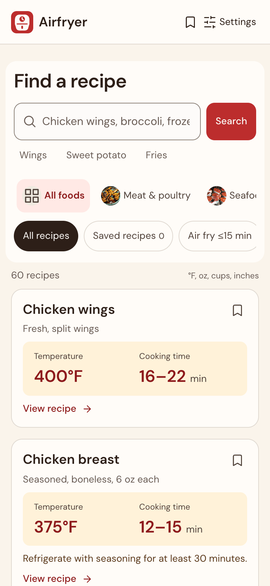
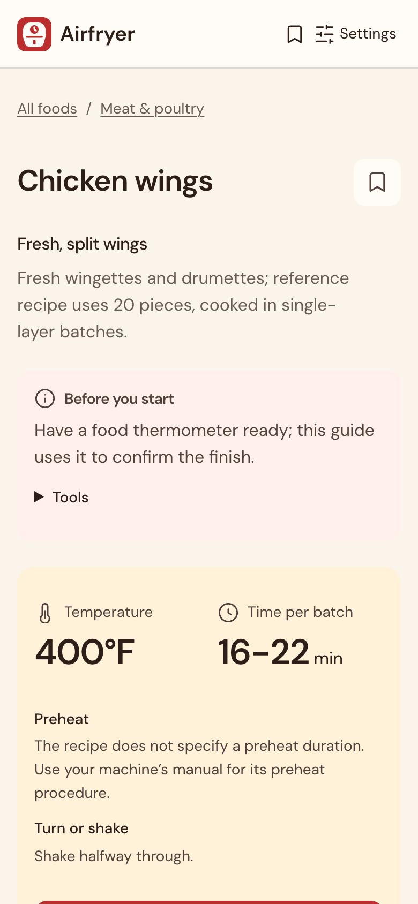
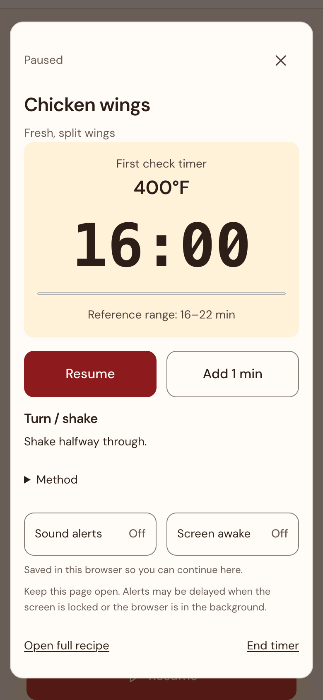

# Airfryer times

Find an air fryer recipe, check the preparation and settings, then start a timer—on your phone, without an account.

**空气炸锅时间查询：找菜谱、看清准备要求与时间温度，入锅后直接开始计时。支持中文和英文，无需注册。**

[Open the app](https://airfryer.ybwdaisy.com) · [打开中文版](https://airfryer.ybwdaisy.com/zh) · [简体中文说明](README.zh-CN.md) · [MIT license](LICENSE)

## A look inside

**Find a recipe → Read the method → Start the timer**

<p>
  
  
  
</p>

Actual website screenshots, captured on November 26, 2026. The timer is paused in the screenshot. [See the Chinese interface](README.zh-CN.md#界面预览).

## What it does

- **Search 115 recipes across six categories.** Meat, seafood, vegetables, frozen food, baking and reheating. Search supports English spelling variations, Chinese aliases, traditional characters and pinyin.
- **See what to do before cooking.** Each method specifies its starting condition, portion, preparation, preheating, time and temperature, turning instructions and checks before serving. Extra equipment or advance preparation is shown up front.
- **Keep your kitchen preferences.** Save a metric or US unit preset and choose English or Chinese independently. The default list only shows methods available in your chosen temperature scale; search can also find other matching foods. Appliance settings keep their original sourced units.
- **Cook with a built-in timer.** Start from the recipe, pause, add a minute or minimize the timer while reading. Multi-stage methods stop for a food check and explicit confirmation before the next stage. Reminders follow the source instructions.
- **Save recipes for next time.** Bookmarks, preferences and the current timer stay in the same browser. No account or application backend is required.

## How to use it

1. **Open [the app](https://airfryer.ybwdaisy.com)** and choose your unit preset and interface language in **Settings**. Your choice is saved for later visits when browser storage is available.
2. **Find your food.** Search by name or browse a category. Filters include saved recipes, air-frying time of 15 minutes or less, and methods that need no hob.
3. **Match the preparation.** Check whether the food should be frozen, thawed, ready to bake or already cooked. Follow the portion, marinating, equipment and preheating requirements on the recipe.
4. **Put the food in the basket and tap “Start timer.”** Follow turning reminders and check the food when prompted. Keep the page open; sound alerts can be delayed while the screen is locked or the browser is in the background.

Cooking times are references. A timer finishing is a prompt to check the food. Recipes include source notes and safety guidance; this project has not performed physical cooking tests. Read [Sources & safety](https://airfryer.ybwdaisy.com/methodology) for the approach.

## Run locally

Use **Node.js 24 LTS** and npm.

```bash
git clone https://github.com/ybwdaisy/airfryer.git
cd airfryer
npm ci
npm run dev
```

Open [localhost:4327](http://localhost:4327). Local and preview builds keep analytics disabled.

```bash
npm run check   # Astro and TypeScript checks
npm test        # Unit tests
npm run build   # Validate recipe data and funnel configuration, then build the static site
```

Built with **Astro, TypeScript, CSS, Fuse.js and Zod**. See the [development guide](docs/development.md) for browser tests, project structure and deployment.

## Contributing

Bug reports and improvements are welcome through [Issues](https://github.com/ybwdaisy/airfryer/issues) and pull requests. Include the page, language, unit preset and steps to reproduce a problem.

For recipe changes, follow the [data contract](docs/data-contract.md): preserve the exact preparation conditions and provide independently authored sources. Keep appliance settings, ingredient units and food-center safety temperatures distinct.

## License

Original project code and project-authored content use the [MIT license](LICENSE). Photographs, fonts, dependencies and external recipe references retain their own rights and licenses; see [third-party notices](THIRD_PARTY_NOTICES.md).
