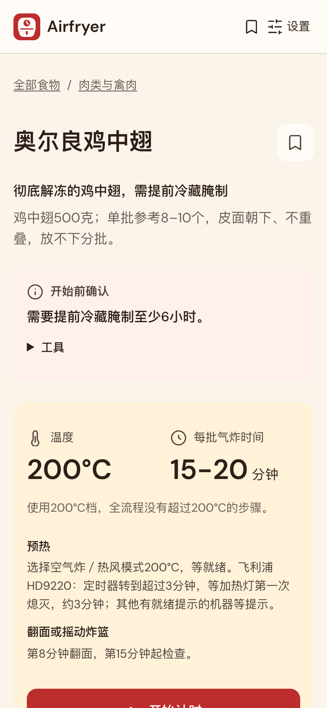
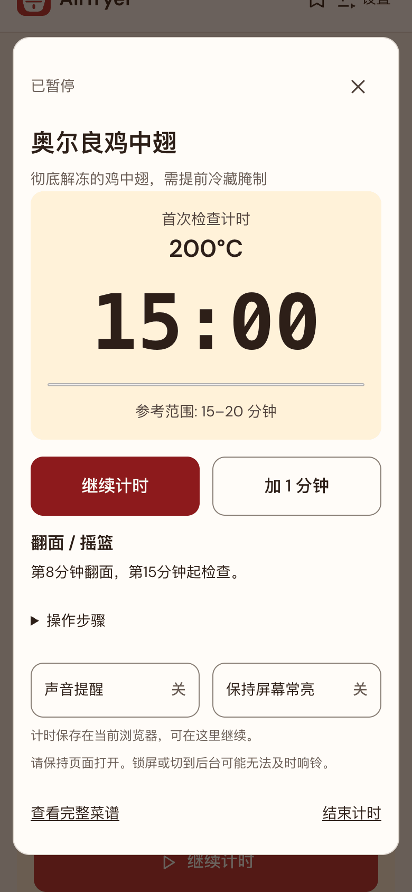

# Airfryer times · 空气炸锅时间查询

找一道菜，看清准备要求与时间温度，食物入锅后直接开始计时。为日常家庭烹饪设计，手机打开就能用，无需注册。

[打开网站](https://airfryer.ybwdaisy.com/zh) · [English](README.md) · [MIT 许可证](LICENSE)

## 界面预览

**找菜谱 → 看做法 → 开始计时**

<p>
  
  
  
</p>

以上为 2026 年 11 月 26 日的真实网站截图，计时器截图处于暂停状态。[查看英文界面](README.md#a-look-inside)。

## 能做什么

- **查找 115 道菜谱。** 覆盖肉类、海鲜、蔬菜、冷冻食品、烘焙和复热六类。支持中文别名、繁体字、拼音，以及英文模糊拼写搜索。
- **先看清准备要求。** 做法注明食物起始状态、分量、腌制、预热、时间温度、翻面和完成检查。需要提前准备或额外使用炒锅的，会在开始前说明。
- **保存一套厨房配置。** 公制或美制单位与界面语言分别设置，保存一次即可。默认只显示所选温标下有可靠做法的菜谱，搜索仍可提示其他匹配食物；炸锅温度保留来源中的原始档位。
- **边看做法边计时。** 从菜谱一键开始，支持暂停、加一分钟和收起后继续看菜谱。分段做法会先停下来让你检查、调整温度，再由你确认进入下一段；翻面或摇动炸篮的提醒依据来源说明。
- **收藏常做的菜。** 收藏、偏好设置和当前计时保存在同一浏览器，无需账户，也不需要应用后端。

## 怎么用

1. **打开[网站](https://airfryer.ybwdaisy.com/zh)**，在「设置」里选择单位预设和界面语言。浏览器允许存储时，下次访问会保留选择。
2. **找到食物。** 输入名称或浏览分类，也可以筛选收藏、气炸时间不超过 15 分钟、无需炒锅的做法。
3. **确认准备条件。** 看清需要冷冻、解冻、待烤还是已熟的食物，按照分量、腌制、工具和预热要求准备。
4. **食物入锅后点「开始计时」。** 按提醒翻面或摇动炸篮，到点后检查食物。请保持页面打开，锁屏或切到后台可能导致声音提醒延迟。

时间仅作参考，计时结束后仍需检查食物。每道做法附有来源与安全说明；本站没有进行实际烹饪测试。可在[来源与安全](https://airfryer.ybwdaisy.com/zh/methodology)了解内容依据。

## 本地运行

建议使用 **Node.js 24 LTS** 和 npm。

```bash
git clone https://github.com/ybwdaisy/airfryer.git
cd airfryer
npm ci
npm run dev
```

打开 [localhost:4327](http://localhost:4327)。本地与预览构建默认关闭统计采集。

```bash
npm run check   # Astro / TypeScript 检查
npm test        # 单元测试
npm run build   # 校验菜谱数据和漏斗配置，构建静态网站
```

项目使用 **Astro、TypeScript、CSS、Fuse.js 和 Zod**。浏览器测试、目录说明与部署方式见[开发指南](docs/development.md)。

## 参与改进

欢迎通过 [Issues](https://github.com/ybwdaisy/airfryer/issues) 或 Pull Request 提交问题和改进。反馈时请提供页面地址、界面语言、单位预设和复现步骤。

补充或修改菜谱前，请遵循[数据规范](docs/data-contract.md)，保留明确的准备条件并提供独立来源，区分炸锅档位、食材单位和食物中心安全温度。

## 开源许可

项目原创代码与原创内容采用 [MIT 许可证](LICENSE)。照片、字体、依赖包和外部菜谱参考保留各自权利与许可，详见[第三方资源说明](THIRD_PARTY_NOTICES.md)。
